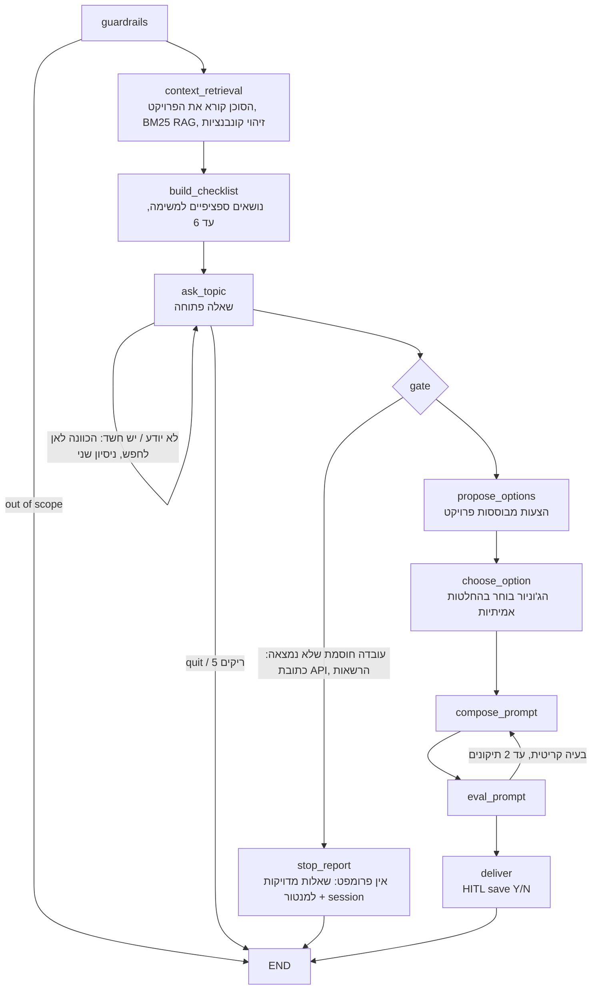

# Readiness Mentor Agent — איג'נט מוכנות לפני מימוש

איג'נט ממוקד שמכוון מפתח ג'וניור **לפני** שהוא מממש משימה: איך לבצע אותה *בפרויקט הזה*. הסוכן קורא את הפרויקט בעצמו ושואל שאלות הכוונה ("האם כבר יש רכיב חיפוש או ספריית רכיבים? איך הפרויקט מביא ושומר נתונים? איפה נמצאים מסכים דומים? מה כתובת ה-REST?"),
מכוון לאן לחפש כשהוא לא יודע, ומפיק פרומפט מקצועי שמבוסס על מה שהג'וניור מסר. המטרה: שהג'וניור יהיה מודע לסגנון הכתיבה בפרויקט, לארכיטקטורה הנכונה, לקוד קיים, לאיכות קוד ולרכיבים שיידרשו בעתיד, **ולא יכתוב קוד רק כי "נראה לו נכון".**

> שני סוגי פערים:
> - **שאלת ארכיטקטורה שהג'וניור לא יודע** (איפה למקם, איזה רכיב, איך שומרים נתונים): הסוכן **מחליט לבד** לפי מה שכבר קיים בפרויקט, ומציין בפרומפט `DECIDED BY THE AGENT`. "אין כזה" = ייווצר רכיב חדש. "יש חשד" = הפרומפט מורה לחפש לפני שיוצרים.
> - **עובדה שאי אפשר להסיק מהקוד** (כתובת ה-REST: שיטה + נתיב, הרשאות, כלל עסקי): הסוכן **לא ממציא**. אם הג'וניור לא יודע גם אחרי הכוונה: **אין פרומפט**, הוא מקבל שאלות מדויקות למנטור וקובץ להמשך. חריג: ה-Backend עדיין לא מוכן ואפשר Mock (לא auth/תשלום/אבטחה) = ממשיכים מול Mock מתויג ASSUMPTION.

> **בלי פרויקט** (`--project` לא ניתן, או שדה הפרויקט בממשק ריק, או שהתיקייה שנבחרה היא תיקיית הסוכן עצמו): הסוכן **לא סורק כלום**, לא מציע קבצים, לא טוען שבדק קונבנציות, ולא מחליט ארכיטקטורה בעצמו. כל ממצא הוא דברי הג'וניור (`DEVELOPER-REPORTED`), הבריף אומר זאת בראשו, וסעיף H מורה לג'וניור לחפש בפרויקט שלו.

## הזרימה (LangGraph + OpenRouter + LangSmith)



## איך כל נושא נשאל (`ask_topic`, בלי LLM, דטרמיניסטי)
**נושא ארכיטקטורה** (מיקום, רכיבים קיימים, מצב, ספריות, שליפה ושמירת נתונים, שימוש חוזר בעתיד):
1. **שאלה פתוחה** בטקסט חופשי. נתיב קובץ, שם ספרייה או תיאור במילים שלך.
2. **בדיקה קלה, לא שער** (`arch.verify_answer`): נתיב שקיים וקשור לנושא, או ספרייה מה-manifest = `verified`; כל תשובה אחרת = `reported`. אין דחייה ואין שאלה חוזרת.
3. **"לא יודע"** → הכוונה: קבצים אמיתיים שאולי קשורים (BM25), מילות חיפוש, תיקיות, ספריות מהפרויקט (הצעות ולא עובדות). אחרי החיפוש: **נתיב** → `verified`; **"אין"** → `absent` (ייווצר חדש, והתאמות אפשריות שנמצאו מופיעות לשלילה); **"יש חשד"** → `suspected` (הפרומפט מורה לחפש לפני יצירה); **"לא יודע"** → `unknown`: שלב ההצעות בוחר את האפשרות שמתאימה ביותר לקונבנציות הקיימות, **הסוכן מחליט** ומסמן `DECIDED BY THE AGENT`.
4. אם המפתח אומר "אין" מיד והחיפוש מצא קבצים קשורים, הסוכן שואל פעם אחת "בטוחים שאין?". אם אחרי זה הוא עדיין אומר "אין", הנושא מסומן `CONFLICTING` (המפתח והחיפוש בפרויקט לא מסכימים) והבריף מורה לשלול את ההתאמות לפני יצירה.
5. **תשובה שלא קשורה לשאלה** (כתובת API כתשובה לשאלת עיצוב, או אותו טקסט כמו בשאלה קודמת) נשאלת שוב פעם אחת; אם חוזרת, נרשמת עם הערה "לא נבדקה".

**עובדה חוסמת** (`api_dependency`, `auth`, או נושא ש-LLM סימן `blocker`):
1. דורשים משהו קונקרטי: שיטה + נתיב/כתובת (`GET /api/...`, `https://...`) או נתיב של קובץ שירות/תיעוד שקיים בפרויקט.
2. "ה-API עדיין לא מוכן" (נושא שאינו auth/תשלום/אבטחה) → `mock_ok`: ממשיכים מול Mock מתויג ASSUMPTION, והחוזה לעולם לא מומצא.
3. לא יודע / תשובה בלי כתובת → הכוונה פעם אחת ("אני לא ממציא אותה") ואז `mentor_needed`: שאלה מדויקת למנטור (שיטה, נתיב, פרמטרים, מבנה תשובה, האם יש Swagger, האם מותר Mock).

**כלל העצירה (`gate`)**: עובדה חוסמת פתוחה = `stop_report`: הודעה עם השאלות למנטור, מה כבר נקבע, וקובץ session. נושאי ארכיטקטורה **אף פעם** לא עוצרים.

**המשך אחרי תשובת המנטור**: `python main.py --resume briefs/session-<id>.json` (או "המשך מקובץ" בממשק). הסוכן **לא שואל מחדש** את מה שכבר נקבע, מבקש רק את תשובות המנטור, ורושם אותן כ-`MENTOR-CONFIRMED (not verified in the project)`: תשובת מנטור היא הצהרה, לא ראיה מהקוד, ואם היא מזכירה נתיב שלא קיים - מסומנת הערת אזהרה.

## אפשרויות פתרון (`propose_options`)
המודל מציע עד 3 החלטות מימוש ועד 3 אפשרויות לכל אחת. `arch.clean_decisions` משאיר רק אפשרות שנשענת על משהו שקיים: קובץ אמיתי או ספרייה שנמצאת ב-manifest. ספרייה חדשה מותרת רק אם סומנה במפורש (`NEW DEPENDENCY`). קבצים מומצאים נופלים. המפתח בוחר מספר, כותב אפשרות משלו (מסומנת "לא מבוססת על הפרויקט") או כותב "המלצה". "לא יודע" אינו בחירה.

## הפרומפט ובקרת האיכות
סעיפים: **R החלטת מוכנות** (`PROCEED` / `PROCEED WITH LIMITS` + רשימת המגבלות), A משימה ודרישות, **B ממצאי ארכיטקטורה** (עם מקור לכל ממצא: `VERIFIED` / `DEVELOPER-REPORTED` / `DOES NOT EXIST (developer-confirmed)` / `SUSPECTED EXISTING` / `UNKNOWN` / `MOCK`), **C החלטות** (של הג'וניור או של הסוכן, מסומנות), D תכנית מימוש, **E זמני ופתוח**, **I מה משתנה כשהתלות האמיתית מתחברת** (רק כשיש API ב-Mock או מדווח), **H לפני שמתחילים**, F בדיקות, **J סיכונים, אישורים ובדיקות**, G הפרומפט לסוכן קוד (נסגר בקוד בסטטוס של כל עובדה ובכללי "לא להמציא"). R, B, C, E, I, H, J נבנים **בקוד**; המודל כותב A, D, F, G. **כתובות API שהמפתח כתב** (בטקסט המשימה, בקובץ מצורף או בכל תשובה, גם תשובה שנשאלה שוב) נאספות בקוד, מופיעות ב-E, ב-R וב-G בסימון "לא אומת", וכתובת שהמודל המציא היא בעיה קריטית. שדות ה-Mock לעולם לא מיוחסים למשימה אם היא לא ציינה אותם, ו-endpoint שדווח מלווה בהוראה "קראו לו ובדקו את התשובה האמיתית".

**סעיף H (הכוונה לג'וניור)**: קונבנציות שהסוכן מצא בעצמו (lint, פורמט, tsconfig, בדיקות, style guide, Storybook), קוד קיים לקרוא ולעשות בו שימוש חוזר, מקומות לחפש בהם לפני יצירה, רכיבים שיידרשו בעתיד (גנרי או מקומי, לפי תשובתו), תזכורות איכות (loading/empty/error, טיפוסים, בדיקות) ו"היזהר": לא לכתוב קוד על סמך הנחה ולא להמציא endpoint, שדה או הרשאה. תזכורות כלליות מסומנות כך ולא כעובדות על הפרויקט.
`eval_prompt`: בדיקות דטרמיניסטיות (נתיב שלא קיים ללא `(new)`, בחירת המפתח חסרה, Mock ללא תיוג ASSUMPTION) + LLM שמחזיר בעיות מובנות. בעיה קריטית = ניסוח מחדש עם הבעיות כמשוב (עד 2); אחרי זה הפרומפט **לא מתקבל** והקובץ נשמר עם `-unaccepted`.

## קוד דטרמיניסטי מול LLM
כל מה שאסור לטעות בו נמצא ב-`agent/arch.py` ובנודים שמדברים עם המפתח (אין בהם קריאת LLM). המודל רק מציע: רשימת נושאים, אפשרויות, ניסוח הפרומפט, ושיפוט סמנטי.

## הרצה
```bash
pip install -r requirements.txt
cp .env.example .env        # OPENROUTER_API_KEY (+ LANGSMITH_API_KEY)
python main.py --project path/to/your/project
```
פקודות: `help`, `/file <path>` (txt/md/docx/קוד), `/summary`, `exit`. נדפס `[INFO] Entering Node: ...` ובסיום עלות ושימוש לכל נוד.
הגדרות אופציונליות ב-`.env`: `READINESS_MAX_CORRECTIONS`, `MENTOR_NAME`, `MAX_OUTPUT_TOKENS` (ברירת מחדל 3000; בלי תקרה OpenRouter שומר קרדיט לפי מקסימום המודל ומחזיר 402 כשהיתרה נמוכה ממנו).
רשת עם סינון HTTPS/אנטי-וירוס (`CERTIFICATE_VERIFY_FAILED`): הסוכן משתמש במאגר התעודות של מערכת ההפעלה דרך `truststore`.
**agent.exe (CLI):** `git tag v1.0.0 && git push origin v1.0.0` מפעיל את `.github/workflows/release.yml`: בונה `agent.exe` ב-Windows, מריץ `--help` כבדיקת עשן ומצרף אותו ל-Release. אפשר גם `build_exe.bat` מקומית. אותו פקודת PyInstaller נבנתה ורצה בהצלחה על Linux (הגרף, ה-help וה-guardrails עובדים בתוך הקובץ הארוז); ב-Windows היא לא נבדקה.
**לפני הגשה:** `python check_submission.py` בודק מבנה, `manifest.json` (placeholders), ש-`.env` לא ב-git, שיש שלושה CSV מהרצה אמיתית ושקיים workflow.

## ממשק ווב (React + FastAPI) - הדרך הקלה לנסות את הסוכן
**לחיצה כפולה על `start_ui.bat`** (Windows) או `./start_ui.sh` (macOS/Linux). זה הכול, בלי להפעיל סביבה וירטואלית ידנית:
בהרצה הראשונה הקובץ יוצר `.venv` בתוך התיקייה, מתקין את התלויות ושואל פעם אחת את `OPENROUTER_API_KEY` (נשמר ב-`.env`). בהרצות הבאות הוא רק מפעיל את השרת ופותח את הדפדפן. תלויות מותקנות מחדש רק אם `requirements.txt` השתנה. הממשק כבר בנוי ב-`ui/dist`, לכן **לא צריך Node.js**.
בטופס יש כפתורי **פרויקט לדוגמה** (`parking_app`, `login_app`, `shop_app`, `sample_project`) כדי לנסות את הסוכן בלי פרויקט משלכם. בלי מפתח ובלי שרת: הוסיפו `?demo` לכתובת למצב הדגמה.

הממשק: טופס משימה (גרירת קבצים, המשך מקובץ session, שדה פרויקט שאפשר להשאיר ריק), ציר התקדמות חי, כרטיסי שאלה חופשית עם הכוונה וכפתורי "אין כזה / יש חשד / לא יודע", כרטיס עובדה חוסמת, כרטיס תשובת מנטור, בחירת אפשרות, **עלות ושימוש כולל טבלת עלות לכל שלב**, **הורדת תקציר שיחה** (Markdown, בכל סוף ריצה), עזרה, וכרטיס **הזנת מפתח OpenRouter** בהרצה ראשונה כשאין `.env` (נשמר רק במחשב שלכם ב-`~/.readiness-mentor/.env`, בהרשאות 600, ואינו מוחזר לדפדפן). מסך תוצאה בסיסי; תצוגה מלאה (טאבים, בריף מתקפל) תבוא בשלב הבא.
פיתוח הממשק (דורש Node.js): `cd ui && npm install && npm run build`; לפיתוח חי `python -m agent.server` בטרמינל אחד ו-`npm run dev` בשני. בדיקות: `cd ui && npm test`.
השרת הוא **FastAPI + uvicorn** (`agent/server.py`) ומאזין רק ל-localhost; הוא דורש כותרת `X-Readiness-UI` ובדיקת Host/Origin כדי שדף זר לא יוכל להפעיל את הסוכן על התיקיות שלך. הפרוטוקול: `POST /api/run`, `POST /api/resume` (NDJSON), `POST /api/key`, `GET /api/config`.

## אפליקציית Desktop (מסלול B: React + Tauri + FastAPI sidecar)
`src-tauri/` הוא מעטפת Tauri 2: היא מפעילה את ה-sidecar הארוז (`agent-server`, אותו שרת FastAPI עם הממשק בתוכו) על פורט חופשי, ממתינה שיענה, פותחת חלון עליו, ועוצרת אותו כשהאפליקציה נסגרת. קבצים שהסוכן שומר (`briefs/`) נכתבים ל-`~/.readiness-mentor/work`.
```bash
pip install -r requirements.txt pyinstaller
python build_sidecar.py        # בונה את הממשק (אם חסר), את ה-sidecar ב-PyInstaller, ומציב אותו ב-src-tauri/binaries/
cargo install tauri-cli --version "^2" --locked
cargo tauri build              # מתקין NSIS ב-src-tauri/target/release/bundle/nsis/
```
ב-CI: `git tag v1.0.0 && git push origin v1.0.0` בונה גם את `agent.exe` (CLI) וגם את מתקין ה-Desktop ומצרף אותם ל-Release (`.github/workflows/release.yml`).
**מה נבדק:** ה-sidecar נבנה ורץ כקובץ אחד על Linux (מגיש את הממשק, סוג קובץ נכון ל-JS, כרטיס מפתח); מעטפת Tauri עברה `cargo check` ו-`cargo build` על Linux ורצה תחת מסך וירטואלי: הפעילה את ה-sidecar, חיכתה לו ופתחה חלון עם הממשק. **מה לא נבדק:** בניית מתקין NSIS והרצה ב-Windows (WebView2), והורדת קבצים מתוך החלון (תקציר, פרומפט) בחלון Tauri.

## בדיקות
```bash
pip install pytest && python -m pytest tests -q      # סוכן + שרת
cd ui && npm test                                      # ממשק (node --test)
```
153 בדיקות Python: יחידות (`test_arch_units.py`: אימות תשובות, כוונות, אפשרויות, בדיקות פרומפט), תרחישי זרימה מקצה לקצה (`test_flow.py`, כולל תרחיש החניון, "אין / יש חשד / לא יודע", החלטת הסוכן בשאלות ארכיטקטורה, עצירה על עובדה חוסמת והמשך מ-session, סעיף H, Mock, בחירות לא תקינות), שרת מעל HTTP אמיתי (`test_server.py`) ו-CLI/evals, ו-`test_v9.py` (מצב "אין פרויקט", זיהוי תשובה לא קשורה, סעיפי R/I/J, `CONFLICTING`). `test_desktop.py` (עקביות האריזה). בנוסף 38 בדיקות ממשק.
**ה-LLM בבדיקות הוא סקריפט** (כולל פלטים גרועים בכוונה): הן מוכיחות שהמגנים בקוד עובדים, לא את איכות המודל. נבדקה גם הסרת כל מגן בנפרד (מוטציה) והבדיקות נכשלו כנדרש.

## Evals (CSV ב-`evals/results/`, דורשים מפתח אמיתי)
```bash
python evals/run_all.py                      # שלושתם ברצף, ורשימת קובצי ה-CSV
# או בנפרד:
python evals/compare_models.py --models "meta-llama/llama-3.3-70b-instruct:free,openai/gpt-4o-mini"
python evals/cost_eval.py
python evals/scope_eval.py
```
צריך לפחות מודל אחד בתשלום (דרישת הקורס) וקרדיט בחשבון OpenRouter. ה-CSV לא נוצרים בסביבת הפיתוח (אין שם מפתח) - יש להריץ ולהגיש אותם.
`compare_models`: זמן, שישה קריטריוני שופט (`rubric.md`, מודל שופט קבוע) **ו**מדדים דטרמיניסטיים (נתיבים מומצאים, נושאים שאומתו, נושאים למנטור, החלטות, תיקונים). הג'וניור המדומה אומר "לא יודע" ואז עונה עם הקבצים שההכוונה הציגה.
פרויקטים: `evals/sample_project` (חיישנים), `evals/fixtures/parking_app` (תרחיש החניון: אין API ואין תיעוד שלו), `login_app`, `shop_app`. מחירי המודלים ב-`agent/llm.py` מקורבים - עדכנו לפני `cost_eval`.

## מבנה
```
agent/   graph.py nodes.py arch.py tools.py cli.py server.py (+ llm.py prompts.py state.py)
ui/      Vite + React (src/, tests/)
evals/   compare_models.py cost_eval.py scope_eval.py run_all.py rubric.md results/ sample_project/ fixtures/
tests/   test_arch_units.py test_flow.py test_v9.py test_server.py test_desktop.py test_cli_and_evals.py conftest.py
manifest.json  requirements.txt  .env.example  start_ui.bat  start_ui.sh  build_exe.bat  main.py  check_submission.py  build_sidecar.py  sidecar_main.py
src-tauri/   Tauri 2: Cargo.toml tauri.conf.json src/main.rs capabilities/ icons/
.github/workflows/release.yml   (בונה agent.exe ומצרף ל-Release)
```
